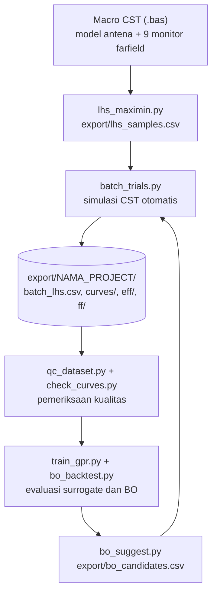

# Optimasi Antena Mikrostrip U-Slot + DGS Dumbbell dengan GPR dan Bayesian Optimization (CST Studio Suite)

Otomasi simulasi **CST Studio Suite 2024** dari Python untuk merancang antena mikrostrip **U-Slot dengan Defected Ground
Structure (DGS) berbentuk dumbbell** pada substrat FR-4, target **5G Sub-6 GHz (3,3–3,7 GHz)**. Alurnya: desain eksperimen
**Latin Hypercube Sampling (maximin)** → simulasi batch otomatis di CST → surrogate **Gaussian Process Regression (GPR)** →
**Constrained Bayesian Optimization (Expected Improvement × Probability of Feasibility)**.

> Seluruh pekerjaan berbasis simulasi (belum ada fabrikasi).

**Target spesifikasi (proposal):** frekuensi resonansi 3,3–3,7 GHz, return loss ≤ −10 dB, bandwidth ≥ 200 MHz, gain ≥ 5 dBi.

---

## 1. Alur kerja



Satu siklus BO: `bo_suggest.py` mengusulkan kandidat → `batch_trials.py --samples ...` mensimulasikannya → hasil otomatis
ditambahkan ke dataset → ulangi.

---

## 2. Isi repositori

| Berkas | Fungsi |
|---|---|
| `antena_uslot_dgs_dumbbell4.bas` | Macro VBA CST **(aktif)**: menggambar model, port, solver 2,5–4,5 GHz, dan 9 monitor farfield (2,5–4,5 GHz, langkah 0,25). `...dumbbell3.bas` = versi lama (satu monitor). |
| `lhs_maximin.py` | Pembangkit sampel LHS maximin untuk 11 parameter + penyaring aturan geometri. Juga **sumber tunggal rentang parameter (`BOUNDS`)**. |
| `batch_trials.py` | Menjalankan batch: atur parameter → solver → ekspor farfield → ekstrak data → tulis CSV. Mendukung resume. |
| `export_dataset.py` | Ekstraksi satu baris data per sampel (S11, efisiensi, directivity, gain). Dipanggil `batch_trials.py`. |
| `farfield_utils.py` | Pembaca hasil ekspor farfield ASCII CST dan konversi satuan efisiensi. |
| `dialog_watcher.py` | Proses latar belakang yang menekan tombol *Yes* hanya pada dialog CST yang dikenal (`recalculate`, `abort this calculation`). |
| `qc_dataset.py` | Pemeriksaan kualitas dataset (jumlah, ganda, parameter cocok, NaN, monitor, kurva) + ringkasan sebaran. |
| `check_curves.py` | Memverifikasi kurva S11 di `curves/` konsisten dengan kolom CSV (bukan kurva salah folder/buatan). |
| `ml_core.py` | Inti GPR (kernel ARD) dan Constrained BO, tidak bergantung pada desain antena tertentu. |
| `design_uslot_dgs.py` | **Satu-satunya file spesifik desain**: parameter, rentang, kolom target, objective, constraint, aturan geometri. |
| `train_gpr.py` | Melatih dan mengevaluasi GPR (split 80/20, cross-validation, kalibrasi ketidakpastian, sensitivitas parameter). |
| `bo_suggest.py` | Mengusulkan *q* kandidat berikutnya (batch) dan menggambar kurva konvergensi. |
| `bo_backtest.py` | Menguji BO vs pencarian acak pada dataset yang sudah ada (tanpa simulasi baru). |
| `requirements.txt` | Dependensi Python (versi dikunci). |

Berkas lain di repo (mis. `batch_run.py`, `test_cst_import.py`, `Automate_CST.py` lama) tidak termasuk alur di dokumen ini.

**Keluaran** (folder `export/`):

```
export/
├── lhs_samples.csv              sampel LHS (masukan batch)
├── bo_candidates.csv            kandidat BO (masukan batch) + bo_candidates_report.csv (prediksi)
└── <NAMA_PROJECT>/              satu folder per project CST, mis. MicrostripAntena/
    ├── batch_lhs.csv            DATASET: satu baris per sampel
    ├── curves/s11_sample<id>.csv   kurva S11 per sampel
    ├── eff/eff_sample<id>.csv      kurva efisiensi per sampel
    ├── ff/                         file farfield mentah
    └── gpr_*.csv/png/joblib, bo_*.png   hasil ML
```

---

## 3. Persiapan

**Kebutuhan:** Windows, CST Studio Suite 2024 (dengan Python API), Python 3.10.

```bat
python -m venv cst_env
cst_env\Scripts\activate
pip install -r requirements.txt
```

> Semua berkas `.py` harus berada di **folder yang sama** (`design_uslot_dgs.py` mengimpor `lhs_maximin.py`).

### Parameter desain (11 variabel)

| Parameter | Arti | Baseline (mm) | Rentang saat ini (mm) |
|---|---|---|---|
| `Lp` / `Wp` | panjang / lebar patch | 20,22 / 26,33 | 20–23 / 24–29 |
| `LU` / `WU` | panjang / lebar luar U-Slot | 10,0 / 10,5 | 6–10,5 / 7–13 |
| `gU` | lebar celah U-Slot | 0,6 | 0,4–1,2 |
| `PU` | posisi U-Slot terhadap pusat patch | 2,0 | −1–3,5 |
| `LI` | kedalaman inset feed | 6,15 | 4,5–7 |
| `LD` / `WD` | panjang / lebar kepala DGS dumbbell | 3,0 / 3,0 | 2–5 / 2–5 |
| `gD` | lebar penghubung DGS | 0,3 | 0,2–1,0 |
| `PD` | posisi DGS | 0,0 | −3–3 |

Tetap: substrat FR-4 (lossy) h = 1,6 mm, tembaga 0,035 mm, feed microstrip inset 50 Ω (Wf = 3,11 mm).
Rentang diubah di `lhs_maximin.py` (`BOUNDS`).

---

## 4. Cara pemakaian

Semua perintah dijalankan dari folder repo dengan `cst_env` aktif. Ganti `batch_trials.py` dengan nama salinan Anda bila berbeda.

### Langkah 1 – Bangun model di CST
1. Buka CST, buat project MWS baru, jalankan macro `antena_uslot_dgs_dumbbell4.bas` (menu *VBA Macros*).
2. Simpan sebagai `MicrostripAntena.cst` (**wajib disimpan**; hasil dibaca dari file di disk).
3. Pastikan di Navigation Tree ada 9 plot di folder `Farfields`. Jika rentang atau langkah monitor diubah, samakan
   `MON_START / MON_STOP / MON_STEP` di `export_dataset.py` dengan `FF_F_START / FF_F_STOP / FF_F_STEP` di macro.

### Langkah 2 – Bangkitkan sampel LHS
```bat
py lhs_maximin.py                 :: 80 sampel, seed 42 -> export\lhs_samples.csv
py lhs_maximin.py -n 60 --seed 7 --report
```

### Langkah 3 – Uji sebelum batch penuh
```bat
py batch_trials.py --probe            :: koneksi, API, dan project yang terdeteksi
py batch_trials.py --check-samples    :: validasi CSV sampel (tanpa CST)
py batch_trials.py --check-monitors   :: kurva efisiensi harus punya 9 titik (setelah 1 simulasi tersimpan)
py batch_trials.py --limit 2 --auto-yes   :: dua sampel penuh
```

### Langkah 4 – Jalankan batch
```bat
py batch_trials.py --auto-yes
```
- **Resume otomatis**: sampel yang parameternya sudah ada di `batch_lhs.csv` dilewati. Jika terputus, jalankan perintah yang sama.
- `--samples <csv>` pilih berkas sampel (mis. `export\bo_candidates.csv`), `--start N`/`--limit N` batasi sampel,
  `--reuse-results` pakai hasil CST yang sudah ada untuk parameter yang sama (lewati solver),
  `--project <file.cst>` jika project aktif tidak terdeteksi.
- Skrip menolak berjalan bila `--project` berbeda dari project yang aktif di CST (mencegah data dua project tercampur).
- Satu simulasi ≈ 4–6 menit.

### Langkah 5 – Periksa kualitas data
```bat
py qc_dataset.py       :: harus "Semua pemeriksaan lulus"
py check_curves.py     :: harus "kurva KONSISTEN"
```

### Langkah 6 – GPR dan BO
```bat
py train_gpr.py                     :: akurasi tiap target (lihat kolom R2_cv), sensitivitas parameter
py bo_backtest.py --reps 10         :: apakah BO lebih baik dari acak pada data yang ada
py bo_suggest.py --report           :: kurva konvergensi
py bo_suggest.py -q 5               :: 5 kandidat berikutnya -> export\bo_candidates.csv
py batch_trials.py --samples export\bo_candidates.csv --auto-yes   :: simulasikan kandidat, lalu ulangi bo_suggest.py
```
Opsi berguna: `train_gpr.py --kernel both` (bandingkan RBF vs Matérn), `bo_suggest.py --spread 0.3` (jarak minimum antar
kandidat dalam satu batch). Id kandidat BO selalu > `N_INITIAL` (mulai dari 81).

### Mengganti objective, constraint, atau desain
Seluruhnya di `design_uslot_dgs.py` (`OBJECTIVE`, `CONSTRAINTS`, `TARGETS`, `TRANSFORMS`; ada blok komentar untuk tahap
berikutnya). Untuk desain antena lain, salin file itu menjadi `design_baru.py`, ubah isinya, lalu jalankan skrip ML dengan
`--design design_baru`.

---

## 5. Kolom dataset (`batch_lhs.csv`)

| Kolom | Arti |
|---|---|
| `fr_ghz`, `rl_min_db`, `vswr` | frekuensi dan nilai minimum S11 (global), VSWR |
| `bw_mhz`, `band_cover_pct` | lebar pita S11 ≤ −10 dB di sekitar minimum; persen pita 3,3–3,7 GHz yang tercakup |
| `s11_at_f0_db`, `fr_edge_flag` | S11 di 3,5 GHz; 1 bila `fr` menempel di tepi sweep (2,5/4,5 GHz) |
| `eta_rad`, `eta_tot`, `eta_rad_fr` | efisiensi radiasi/total di 3,5 GHz; efisiensi radiasi di `fr` (interpolasi) |
| `f_mon_fr_ghz`, `n_eff_points` | monitor terdekat `fr`; jumlah titik kurva efisiensi (harus 9) |
| `d_peak_dbi`, `d_peak_fr_dbi` | directivity puncak di 3,5 GHz dan di monitor terdekat `fr` |
| `gain_fr_ieee_dbi`, `gain_fr_real_dbi` | gain di sekitar `fr` (tanpa/dengan mismatch). `gain_ieee_dbi`/`gain_real_dbi` = di 3,5 GHz |
| `feasible_wo_gain`, `feasible_all` | memenuhi spesifikasi tanpa/dengan syarat gain |

Fitur turunan untuk ML dihitung dari `curves/`: `rl_band_min_db`, `rl_band_max_db`, `rl_band_mean_db`,
`dip_dist_ghz`, `dip_nearest_db`.

---

## 6. Masalah yang sering muncul

| Gejala | Penyebab / solusi |
|---|---|
| `ModuleNotFoundError: lhs_maximin` | Berkas `.py` tidak berada di folder yang sama. |
| `PermissionError ... batch_lhs.csv` | CSV sedang terbuka di Excel. Tutup, lalu jalankan ulang. |
| `run_solver ... Terminated on unknown error` | Sering muncul setelah hasil selesai dihitung; skrip memeriksanya dan melanjutkan. |
| `Not enough memory` pada satu sampel | Jalankan ulang perintah yang sama (sampel gagal dicoba lagi). Tutup program lain; restart CST tiap ±40 simulasi. |
| Dialog "All required results are already present" | Gunakan `--auto-yes` atau `--reuse-results`. |
| Ctrl+C saat solver berjalan | Solver mungkin masih jalan; hentikan di CST (Stop) dulu sebelum menjalankan ulang. |
| `Project tidak bisa dideteksi` | Berikan `--project "C:\...\MicrostripAntena.cst"`. |
| `ASCII export option is not available` | Monitor farfield tidak lengkap / nama item tidak cocok dengan `MON_*`. |

`--auto-yes` hanya menekan *Yes* pada dialog dengan teks yang diizinkan; dialog Yes/No lain dibiarkan dan diberi peringatan.

---

## 7. Progres saat ini  *(diperbarui: Oktober 2026)*

### Selesai
- [x] Model CST (macro v4) dengan 9 monitor farfield; port, material, dan solver tervalidasi berjalan.
- [x] Otomasi: pengaturan parameter, solver, ekspor farfield, ekstraksi S11/efisiensi/gain, resume, penekan dialog aman.
- [x] LHS maximin **80 sampel** dan **80/80 simulasi selesai**; QC dataset lulus. S11 identik antar-project (reproduksibel).
- [x] GPR, BO, dan backtest berjalan pada data nyata.
- [x] **BO putaran 1** (5 kandidat, id 81–85) disimulasikan.

### Hasil 80 sampel LHS (rentang awal)

| Hal | Hasil |
|---|---|
| `fr` di 2,5–2,9 / 2,9–3,3 / **3,3–3,7** / 3,7–4,1 / 4,1–4,6 GHz | 36 / 17 / **1** / 15 / 11 sampel |
| RL ≤ −10 dB | 17 sampel (semuanya di luar pita 3,3–3,7 GHz) |
| BW maksimum | 99 MHz (target ≥ 200 MHz) |
| Gain di `fr` (IEEE) | median 1,10 dBi, **maksimum 3,13 dBi** (target ≥ 5 dBi) |
| Directivity di `fr` | 5,23–6,73 dBi |

**Akurasi GPR (R² cross-validation, 80 sampel):** `rl_min_db` 0,81 · `d_peak_fr_dbi` 0,65 · `eta_rad_fr` 0,63 · `fr_ghz` 0,46 ·
`rl_band_min_db` 0,45 · `gain_fr_ieee_dbi` 0,30 · `bw_mhz` −3,5 (79% nilainya 0). Target proposal R² ≥ 0,85 belum tercapai
untuk target yang bermakna.

**Backtest BO vs acak (10 ulangan):** sampel terbaik ditemukan pada 30 evaluasi di 80% ulangan (acak: 20%), dan pada 40
evaluasi di 100% (acak: 50%).

### BO putaran 1 (objective `rl_band_min_db`)

| Sampel | `fr` (GHz) | RL (dB) | BW | Gain di `fr` (dBi) |
|---|---|---|---|---|
| 81 | 3,472 | −6,27 | 0 | 2,39 |
| 82 | 3,468 | −6,01 | 0 | 2,40 |
| 83 | 3,502 | −6,68 | 0 | 2,06 |
| 84 | 3,632 | −6,61 | 0 | 2,41 |
| 85 | 3,460 | −6,29 | 0 | 2,50 |

BO berhasil menaruh resonansi **di pita (5 dari 5; LHS: 1 dari 80)**, tetapi kedalaman match belum tercapai (prediksi
−11,5 dB; aktual −6 sampai −6,7 dB), sehingga BW masih 0.

### Temuan
- `fr` terbelah dua kelompok (≈2,5–3,25 dan ≈3,5–4,5 GHz) dengan celah di tengah → `fr = argmin S11` melompat antar mode.
  Itu sebabnya GPR untuk `fr` lemah; fitur `dip_dist_ghz` dibuat sebagai pengganti yang kontinu (belum dievaluasi).
- Panjang slot `LU` paling mengendalikan resonansi (relevansi ARD terbesar).
- Pada kelima kandidat BO, **8 dari 11 parameter berada di batas rentang** → kotak rentang membatasi. Parameter DGS
  (`LD`, `gD`, `PD`) didorong ke nilai berefek minimum dan efeknya pada RL kecil di model (dugaan; belum diuji langsung).
- Gain ≥ 5 dBi tampaknya tidak dapat dicapai satu patch FR-4 (efisiensi radiasi di `fr` hanya ≈ 0,3–0,4).

### Berikutnya
- [ ] Sapuan `PU` dari sampel 83 (4 simulasi, `sweep_PU_from83.csv`, id 86–89) untuk menguji parameter pengatur match.
- [ ] Tahap 2: geser/perluas rentang (`Lp`, `Wp`, `LU` ke atas; `LI` ke bawah), kunci parameter yang tidak berpengaruh.
- [ ] Ubah formulasi BO: minimalkan `rl_min_db` dengan constraint `fr` ∈ [3,3; 3,7] dan `d_peak_fr_dbi` ≥ 4 (blok komentar di `design_uslot_dgs.py`).
- [ ] Ablasi DGS (dengan/tanpa) — butuh saklar `DGS_ON` di macro.
- [ ] Uji konvergensi mesh (sumber noise numerik yang belum terukur) dan validasi patch polos vs model analitis.
- [ ] Bahas spesifikasi gain (≥ 5 dBi) dan BW (≥ 200 MHz) dengan pembimbing: turunkan target, ganti substrat berloss rendah, atau array.
- [ ] Setelah match tercapai: ganti objective ke maksimasi `bw_mhz` dengan constraint RL ≤ −10 dB dan `fr` di pita.
