# Laporan hasil optimasi antena

## 1. Informasi reproduksi

- Tanggal: 2026-11-16
- Commit git: e7e54d45a75f67fe99c08d1113d7320bdc33b48e
- Paket: Python 3.10.0, numpy 2.2.6, pandas 2.3.3, sklearn 1.7.2, scipy 1.15.3, matplotlib 3.10.9
- Sampel per run: MicrostripAntena 156 sampel; MicrostripAntena_RO4350B 185 sampel
- Syarat dasar: fr 3.3 sampai 3.7 GHz dan RL minimum <= -10 dB; desain terbaik dipilih dengan memaksimalkan bw_mhz

## 2. Definisi

- BW: lebar pita S11 <= -10 dB di sekitar minimum global (BW = 0 bila RL minimum > -10 dB).
- Cakupan pita: persentase frekuensi di 3.3 sampai 3.7 GHz dengan S11 <= -10 dB.
- Gain: gain IEEE di frekuensi resonansi (D + 10 log eta).
- Substrat: nilai epsilon dan tan delta di bawah berasal dari file desain; konfirmasikan dengan material library CST.
- Target proposal: fr 3.3 sampai 3.7 GHz, RL minimum <= -10 dB, BW >= 200 MHz, gain >= 5 dBi.

## 3. Target dan hasil tercapai

### MicrostripAntena: skenario syarat dasar

Desain terbaik: sampel 137 (52 sampel memenuhi syarat skenario ini).

| besaran | target proposal | tercapai | selisih terhadap target | status |
|---|---|---|---|---|
| fr (GHz) | 3.3 sampai 3.7 | 3.698 | 2 MHz dari tepi pita terdekat | tercapai |
| RL minimum (dB) | <= -10 | -18.2 | -8.2 dB | tercapai |
| BW (MHz) | >= 200 | 180.6 | -19.4 MHz (90% dari target) | tidak tercapai |
| BW pecahan (%) | tidak ada | 4.88 |  | acuan |
| Cakupan pita (%) | tidak ada | 22.7 |  | acuan |
| Gain IEEE (dBi) | >= 5 | 2.80 | -2.20 dB | tidak tercapai |
| Efisiensi radiasi di fr (%) | tidak ada | 49.4 |  | acuan |
| Directivity di fr (dBi) | tidak ada | 5.87 |  | acuan |

Maksimum terpisah pada skenario ini: BW 180.6 MHz (sampel 137, gain 2.80 dBi); gain 2.89 dBi (sampel 95, BW 126.2 MHz).

### MicrostripAntena_RO4350B: skenario gain_fr_ieee_dbi >= 5

Desain terbaik: sampel 165 (129 sampel memenuhi syarat skenario ini).

| besaran | target proposal | tercapai | selisih terhadap target | status |
|---|---|---|---|---|
| fr (GHz) | 3.3 sampai 3.7 | 3.616 | 84 MHz dari tepi pita terdekat | tercapai |
| RL minimum (dB) | <= -10 | -24.9 | -14.9 dB | tercapai |
| BW (MHz) | >= 200 | 158.6 | -41.4 MHz (79% dari target) | tidak tercapai |
| BW pecahan (%) | tidak ada | 4.39 |  | acuan |
| Cakupan pita (%) | tidak ada | 39.4 |  | acuan |
| Gain IEEE (dBi) | >= 5 | 5.03 | +0.03 dB | tercapai |
| Efisiensi radiasi di fr (%) | tidak ada | 82.3 |  | acuan |
| Directivity di fr (dBi) | tidak ada | 5.67 |  | acuan |

Maksimum terpisah pada skenario ini: BW 158.6 MHz (sampel 165, gain 5.03 dBi); gain 5.82 dBi (sampel 102, BW 115.8 MHz).

### MicrostripAntena_RO4350B: skenario gain_fr_ieee_dbi >= 4

Desain terbaik: sampel 179 (177 sampel memenuhi syarat skenario ini).

| besaran | target proposal | tercapai | selisih terhadap target | status |
|---|---|---|---|---|
| fr (GHz) | 3.3 sampai 3.7 | 3.534 | 166 MHz dari tepi pita terdekat | tercapai |
| RL minimum (dB) | <= -10 | -22.1 | -12.1 dB | tercapai |
| BW (MHz) | >= 200 | 247.5 | +47.5 MHz (124% dari target) | tercapai |
| BW pecahan (%) | tidak ada | 7.00 |  | acuan |
| Cakupan pita (%) | tidak ada | 61.8 |  | acuan |
| Gain IEEE (dBi) | >= 5 | 4.43 | -0.57 dB | tidak tercapai |
| Efisiensi radiasi di fr (%) | tidak ada | 83.4 |  | acuan |
| Directivity di fr (dBi) | tidak ada | 5.17 |  | acuan |

Maksimum terpisah pada skenario ini: BW 247.5 MHz (sampel 179, gain 4.43 dBi); gain 5.82 dBi (sampel 102, BW 115.8 MHz).

## 4. Parameter desain terbaik

### MicrostripAntena: sampel 137 (skenario syarat dasar)

| parameter | nilai (mm) |
|---|---|
| Lp | 17.611 |
| Wp | 23.652 |
| LU | 4.773 |
| WU | 5.480 |
| gU | 0.942 |
| PU | 1.630 |
| LI | 5.900 |
| LD | 3.754 |
| WD | 8.000 |
| gD | 0.545 |
| PD | 0.000 |
| substrat | FR-4 (lossy): epsilon 4.3, tan delta 0.025, h 1.6 mm |

### MicrostripAntena_RO4350B: sampel 165 (skenario gain_fr_ieee_dbi >= 5)

| parameter | nilai (mm) |
|---|---|
| Lp | 17.820 |
| Wp | 30.988 |
| LU | 2.394 |
| WU | 3.956 |
| gU | 0.974 |
| PU | 3.721 |
| LI | 6.736 |
| LD | 4.360 |
| WD | 13.364 |
| gD | 1.062 |
| PD | 0.158 |
| substrat | Rogers RO4350B (lossy): epsilon 3.66, tan delta 0.0037, h 1.524 mm |

## 5. Kurva Pareto

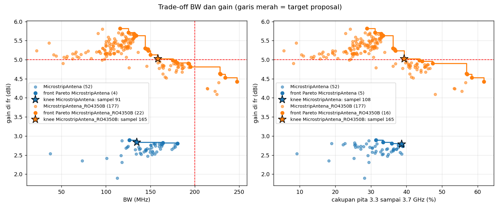

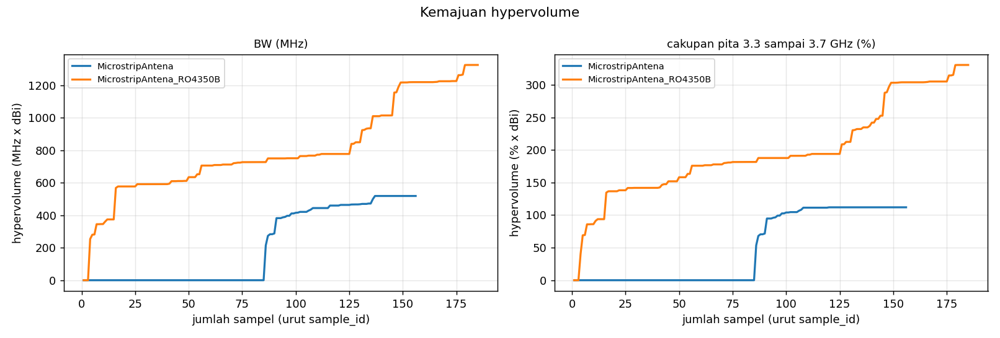

Hypervolume (acuan 0, 0; satuan MHz*dBi untuk BW dan %*dBi untuk cakupan; makin besar makin baik):

| run | sumbu | hypervolume | titik front | knee (sampel) |
|---|---|---|---|---|
| MicrostripAntena | BW | 518.5 | 4 | 91 |
| MicrostripAntena | cakupan pita | 111.9 | 5 | 108 |
| MicrostripAntena_RO4350B | BW | 1324.9 | 22 | 165 |
| MicrostripAntena_RO4350B | cakupan pita | 330.4 | 16 | 165 |

Titik front BW terhadap gain (BW menurun):

**MicrostripAntena**

| sampel | BW (MHz) | gain (dBi) | fr (GHz) | RL min (dB) | cakupan (%) |
|---|---|---|---|---|---|
| 137 | 180.6 | 2.80 | 3.698 | -18.2 | 22.7 |
| 134 | 164.0 | 2.82 | 3.680 | -22.1 | 25.4 |
| 91 | 134.8 | 2.84 | 3.522 | -29.5 | 33.4 |
| 95 | 126.2 | 2.89 | 3.462 | -24.7 | 31.4 |

**MicrostripAntena_RO4350B**

| sampel | BW (MHz) | gain (dBi) | fr (GHz) | RL min (dB) | cakupan (%) |
|---|---|---|---|---|---|
| 179 | 247.5 | 4.43 | 3.534 | -22.1 | 61.8 |
| 176 | 234.2 | 4.53 | 3.514 | -21.1 | 58.4 |
| 178 | 228.9 | 4.62 | 3.544 | -28.7 | 57.1 |
| 180 | 228.2 | 4.63 | 3.514 | -26.4 | 56.9 |
| 173 | 195.1 | 4.81 | 3.616 | -32.2 | 45.4 |
| 174 | 193.4 | 4.89 | 3.650 | -26.3 | 36.9 |
| 167 | 192.8 | 4.90 | 3.606 | -21.7 | 47.4 |
| 136 | 180.1 | 4.92 | 3.622 | -19.0 | 41.4 |
| 185 | 177.9 | 4.96 | 3.456 | -16.4 | 44.4 |
| 166 | 175.1 | 4.98 | 3.604 | -19.4 | 43.6 |
| 165 | 158.6 | 5.03 | 3.616 | -24.9 | 39.4 |
| 145 | 150.0 | 5.13 | 3.694 | -29.8 | 19.7 |
| 128 | 147.5 | 5.24 | 3.608 | -23.1 | 36.9 |
| 130 | 147.2 | 5.28 | 3.614 | -23.4 | 36.7 |
| 126 | 145.7 | 5.28 | 3.600 | -23.1 | 36.2 |
| 127 | 144.2 | 5.30 | 3.614 | -27.3 | 36.2 |
| 112 | 133.9 | 5.63 | 3.604 | -22.2 | 33.4 |
| 110 | 133.1 | 5.65 | 3.614 | -25.1 | 33.2 |
| 96 | 131.6 | 5.66 | 3.618 | -26.0 | 32.9 |
| 87 | 131.5 | 5.68 | 3.616 | -26.1 | 32.9 |
| 105 | 125.2 | 5.71 | 3.590 | -37.5 | 31.2 |
| 102 | 115.8 | 5.82 | 3.592 | -41.2 | 28.9 |

## 6. Overlay S11 desain di front Pareto

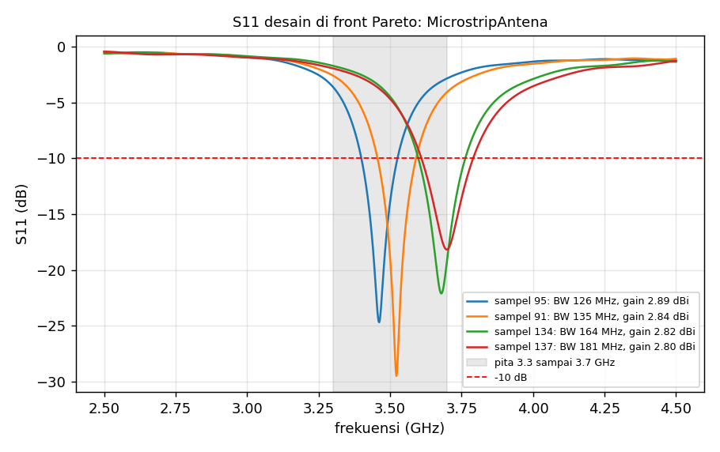

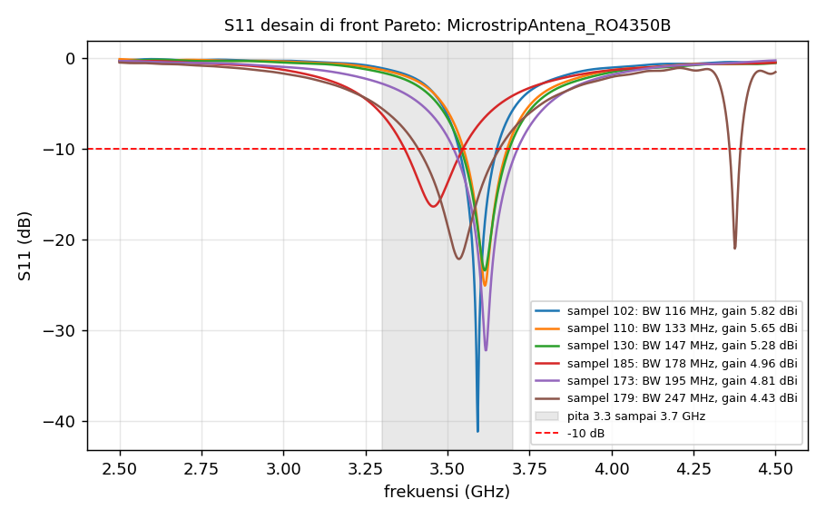

## 7. Metode: konvergensi BO dan model

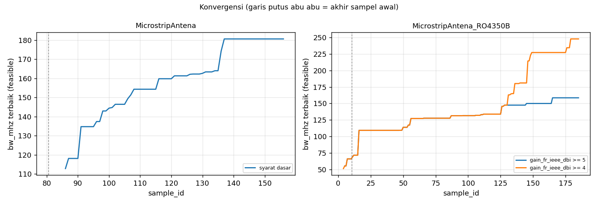

Parity GPR (MicrostripAntena):

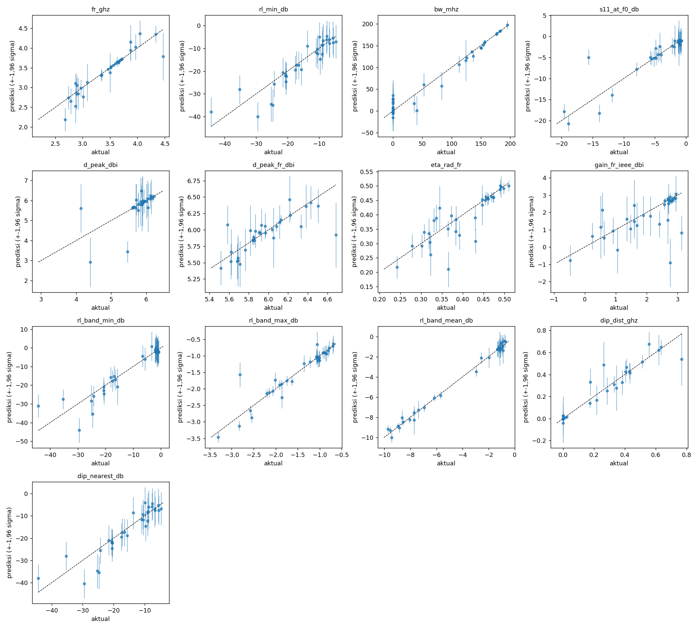

Validasi maju (MicrostripAntena):

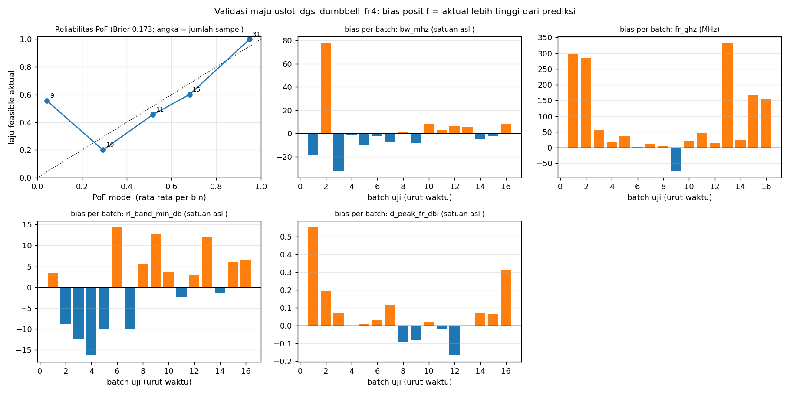

Backtest BO vs acak (MicrostripAntena):

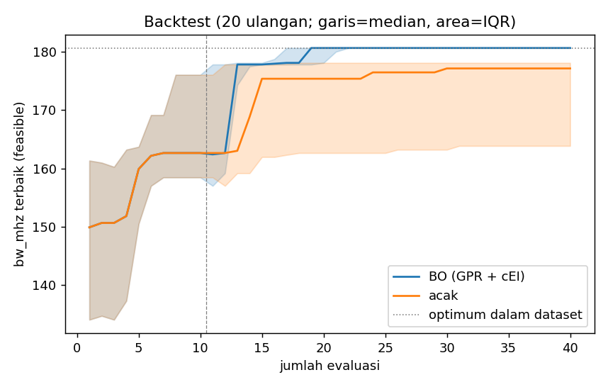

Parity GPR (MicrostripAntena_RO4350B):

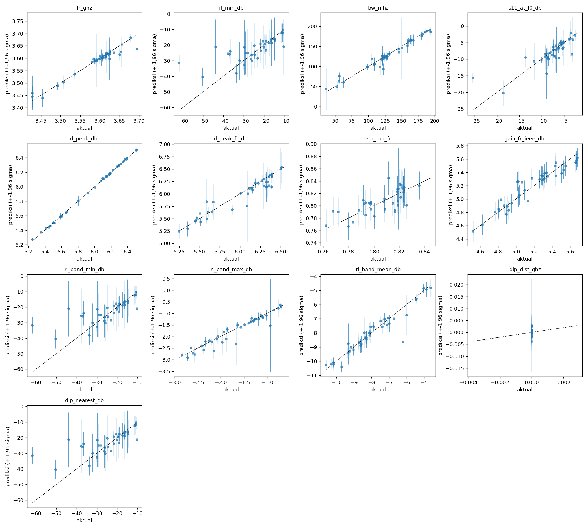

Validasi maju (MicrostripAntena_RO4350B):

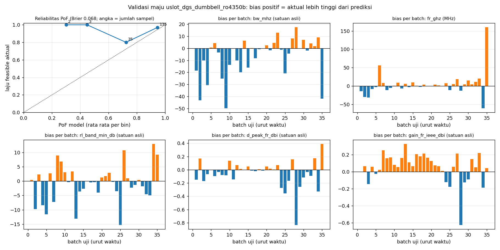

Backtest BO vs acak (MicrostripAntena_RO4350B):

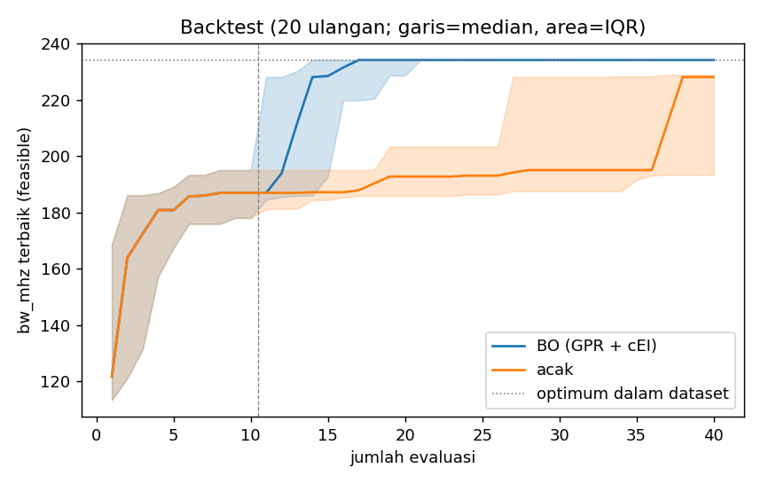

Sensitivitas ARD dan Sobol (MicrostripAntena_RO4350B):

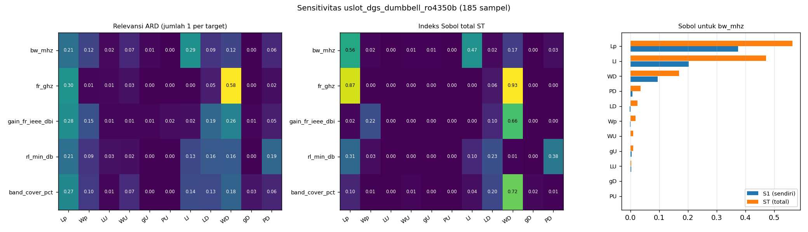

## 8. Catatan otomatis

- Front MicrostripAntena (BW) belum representatif: hanya 4 titik (minimal 6).
- Front MicrostripAntena (cakupan pita) belum representatif: hanya 5 titik (minimal 6).
- Sensitivitas ARD dan Sobol (MicrostripAntena): sensitivity.png belum ada di C:\Users\User\Playground\CST_Auto\data\MicrostripAntena\figures (jalankan train, validate, backtest, atau sensitivity).
- MicrostripAntena: 2 sampel punya fr menempel di tepi sweep; resonansi sebenarnya mungkin di luar rentang sweep.
