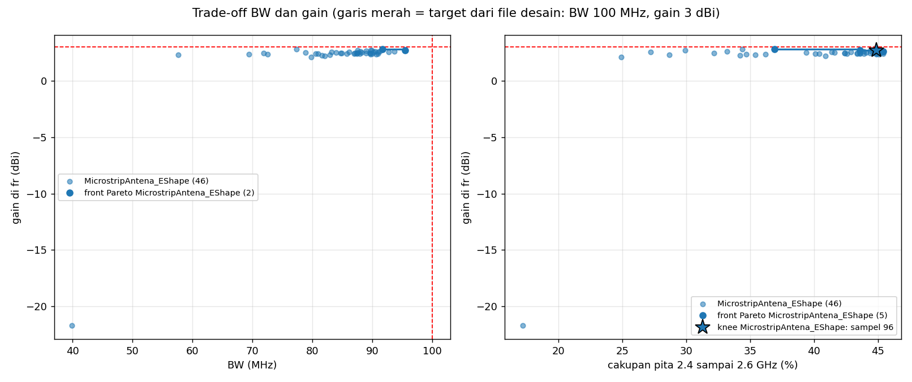
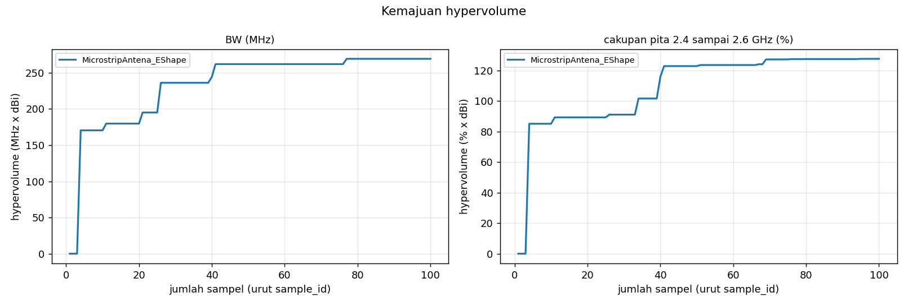
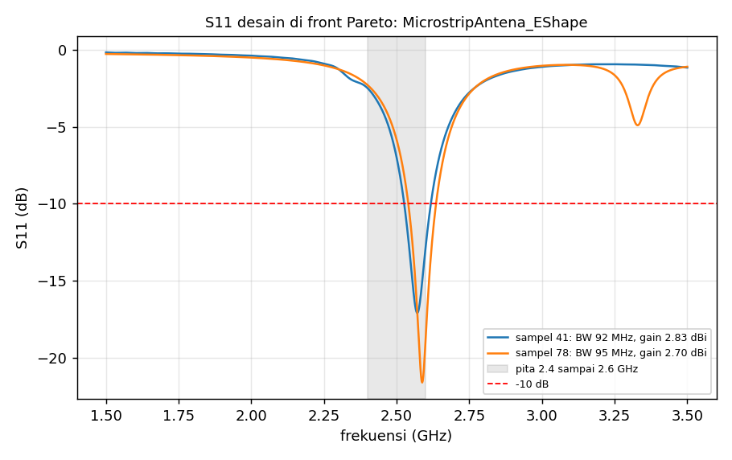
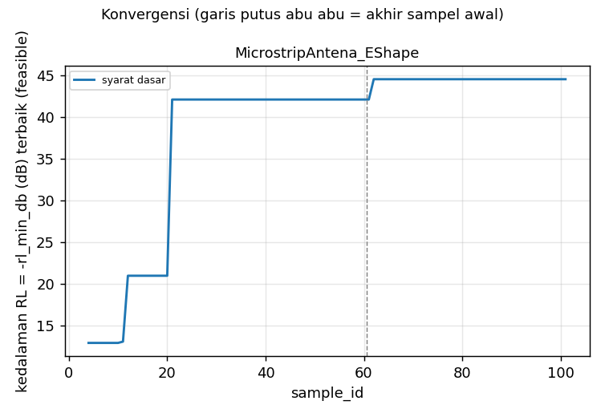
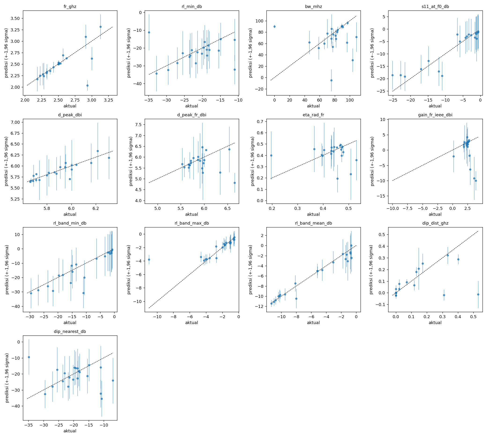
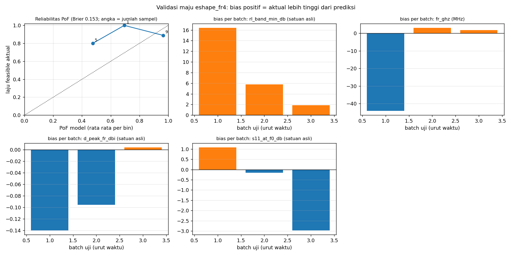
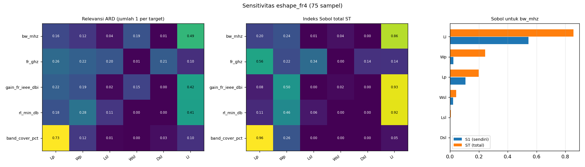
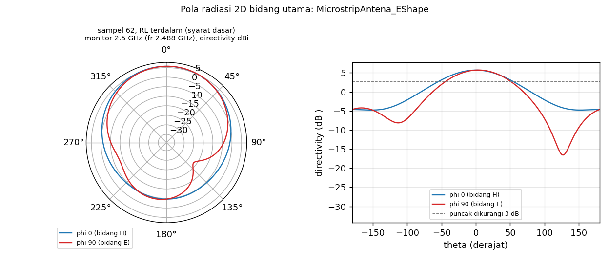
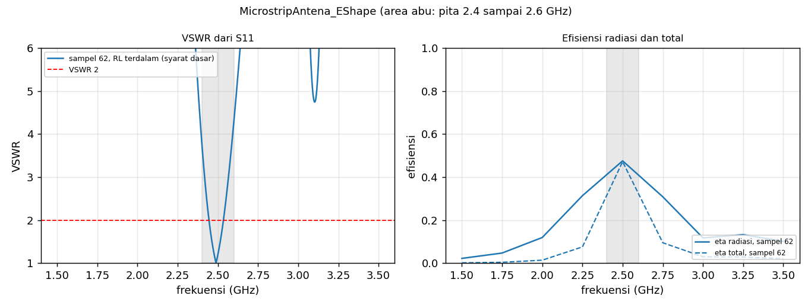
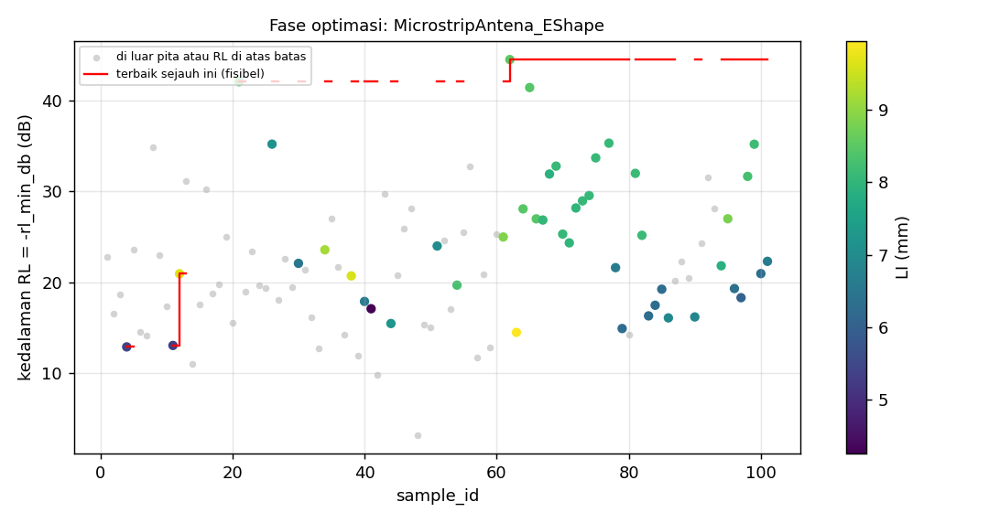

# Laporan hasil optimasi antena

## 1. Informasi reproduksi

- Tanggal: 2026-11-24
- Commit git: ce6d2480165a9d80237f3360da93a12f7e1658f6
- Paket: Python 3.10.0, numpy 2.2.6, pandas 2.3.3, sklearn 1.7.2, scipy 1.15.3, matplotlib 3.10.9
- Sampel per run: MicrostripAntena_EShape 100 sampel
- Syarat dasar: fr 2.4 sampai 2.6 GHz dan RL minimum <= -10 dB; desain RL terdalam dipilih dengan memaksimalkan kedalaman RL = -rl_min_db (dB); desain rekomendasi: RL terdalam di antara desain dengan yield toleransi >= 90%

## 2. Definisi

- BW: lebar pita S11 <= -10 dB di sekitar minimum global (BW = 0 bila RL minimum > -10 dB).
- Cakupan pita: persentase frekuensi di 2.4 sampai 2.6 GHz dengan S11 <= -10 dB.
- Gain: gain IEEE di frekuensi resonansi (D + 10 log eta).
- Substrat: nilai epsilon dan tan delta di bawah berasal dari file desain; konfirmasikan dengan material library CST.
- Target proposal: fr 2.4 sampai 2.6 GHz, RL minimum <= -10 dB, BW >= 100 MHz, gain >= 3 dBi.
- RL minimum: nilai S11 terendah (dB) pada sapuan frekuensi; makin negatif makin baik. Fokus rl memilih desain fisibel dengan RL minimum paling negatif (kedalaman RL = -rl_min_db).

## 3. Target dan hasil tercapai

### MicrostripAntena_EShape: skenario syarat dasar

Desain dengan RL terdalam: sampel 62 (46 sampel memenuhi syarat skenario ini); tanpa data toleransi.

| besaran | target proposal | tercapai | selisih terhadap target | status |
|---|---|---|---|---|
| fr (GHz) | 2.4 sampai 2.6 | 2.488 | 88 MHz dari tepi pita terdekat | tercapai |
| RL minimum (dB) | <= -10 | -44.5 | -34.5 dB | tercapai |
| BW (MHz) | >= 100 | 84.7 | -15.3 MHz (85% dari target) | tidak tercapai |
| BW pecahan (%) | tidak ada | 3.40 |  | acuan |
| Cakupan pita (%) | tidak ada | 42.4 |  | acuan |
| Gain IEEE (dBi) | >= 3 | 2.49 | -0.51 dB | tidak tercapai |
| Efisiensi radiasi di fr (%) | tidak ada | 46.8 |  | acuan |
| Directivity di fr (dBi) | tidak ada | 5.71 |  | acuan |

RL terdalam pada skenario ini: -44.5 dB (sampel 62, fr 2.488 GHz, BW 84.7 MHz, gain 2.49 dBi).

Maksimum terpisah pada skenario ini: BW 95.4 MHz (sampel 78, gain 2.70 dBi); gain 2.83 dBi (sampel 41, BW 91.6 MHz).

Tidak ada sampel yang memenuhi BW >= 100 MHz dan gain >= 3 dBi sekaligus (kedua target proposal). Tidak ada sampel dengan gain >= 3 dBi pada skenario ini.

## 4. Parameter desain terbaik

### MicrostripAntena_EShape: sampel 62 (desain RL terdalam, skenario syarat dasar)

| parameter | nilai (mm) |
|---|---|
| Lp | 28.371 |
| Wp | 31.218 |
| Lsl | 9.423 |
| Wsl | 1.136 |
| Dsl | 6.350 |
| LI | 8.509 |
| substrat | FR-4 (lossy): epsilon 4.3, tan delta 0.025, h 1.6 mm |

## 5. Kurva Pareto

Hypervolume (acuan 0, 0; satuan MHz*dBi untuk BW dan %*dBi untuk cakupan; makin besar makin baik):

| run | sumbu | hypervolume | titik front | knee (sampel) |
|---|---|---|---|---|
| MicrostripAntena_EShape | BW | 269.4 | 2 | tidak ada |
| MicrostripAntena_EShape | cakupan pita | 127.7 | 5 | 96 |

Titik front BW terhadap gain (BW menurun):

**MicrostripAntena_EShape**

| sampel | BW (MHz) | gain (dBi) | fr (GHz) | RL min (dB) | cakupan (%) |
|---|---|---|---|---|---|
| 78 | 95.4 | 2.70 | 2.588 | -21.6 | 29.9 |
| 41 | 91.6 | 2.83 | 2.572 | -17.1 | 36.9 |

## 6. Overlay S11 desain di front Pareto

## 7. Metode: konvergensi BO dan model

Parity GPR (MicrostripAntena_EShape):

Validasi maju (MicrostripAntena_EShape):

Sensitivitas ARD dan Sobol (MicrostripAntena_EShape):

## 8. Catatan otomatis

- Front MicrostripAntena_EShape (BW) belum representatif: hanya 2 titik (minimal 6); rentang front 3.8 hanya 7% dari rentang data 55.5 (minimal 20%).
- Front MicrostripAntena_EShape (cakupan pita) belum representatif: hanya 5 titik (minimal 6).
- MicrostripAntena_EShape: tidak ada data toleransi (tolerance_MicrostripAntena_EShape_yield.csv); desain rekomendasi tidak dibuat. Jalankan tools/analyze_tolerance.py --run MicrostripAntena_EShape.
- Backtest BO vs acak (MicrostripAntena_EShape): bo_backtest.png belum ada di C:\Users\User\Playground\CST_Auto\data\MicrostripAntena_EShape\figures (jalankan train, validate, backtest, atau sensitivity).

## 9. Pola radiasi, metrik tambahan, dan fase optimasi

Bagian ini dibaca dari berkas yang sudah ada (`curves/`, `eff/`, `ff/`, `batch_lhs.csv`). Pola yang tersimpan adalah DIRECTIVITY (dBi) pada irisan phi = 0 dan phi = 90 di frekuensi monitor terdekat dengan fr; gain di tabel ringkas dihitung terpisah dan dibatasi di fr, bukan di seluruh pita. Bidang E atau H ditentukan dari komponen dominan di boresight. Sumbu theta bertanda: sisi positif adalah sisi phi irisan, sisi negatif adalah phi + 180.

### 9.1 MicrostripAntena_EShape

**Tabel ringkas desain final**

| sampel | peran | fr (GHz) | RL min (dB) | VSWR | BW (MHz) | cakupan pita (%) | directivity di fr (dBi) | gain di fr (dBi) | eta radiasi di fr | eta total di fr |
|---|---|---|---|---|---|---|---|---|---|---|
| 62 | RL terdalam (syarat dasar) | 2.488 | -44.508 | 1.012 | 84.660 | 42.400 | 5.715 | 2.487 | 0.468 | 0.453 |

**Pola radiasi 2D (directivity)**

**Metrik pola** (HPBW: lebar sudut dengan directivity di atas puncak dikurangi 3 dB; F/B: puncak dikurangi maksimum di belahan belakang, yaitu sudut 90 derajat atau lebih dari arah puncak; XPD: komponen utama di arah puncak dikurangi komponen silang maksimum di sektor HPBW; nilai di atas sekitar 60 dB mencerminkan batas numerik simulasi pada geometri simetris, bukan komponen silang yang bisa diukur)

| sampel | peran | f (GHz) | phi | bidang | Dmax (dBi) | arah puncak (derajat) | HPBW (derajat) | F/B (dB) | XPD sektor HPBW (dB) | AR boresight (dB) |
|---|---|---|---|---|---|---|---|---|---|---|
| 62 | RL terdalam (syarat dasar) | 2.50 | 0 | H | 5.70 | 0.00 | 109.00 | 6.78 | 32.28 | 40.00 |
| 62 | RL terdalam (syarat dasar) | 2.50 | 90 | E | 5.72 | 3.00 | 94.90 | 9.92 | 94.88 | 40.00 |

**VSWR dan efisiensi terhadap frekuensi**

**Fase optimasi** (titik berwarna: sampel fisibel di pita dengan RL sesuai batas, tanpa syarat gain)

Parameter pewarna: LI (korelasi Spearman +0.54 terhadap kedalaman RL = -rl_min_db (dB) pada sampel fisibel). Lompatan terbesar pada terbaik sejauh ini: 13.0 ke 20.9 pada sampel 12. Nilai maksimum LI sebelum sampel itu 9.94 mm dan sesudahnya 9.99 mm; bila keduanya berbeda jauh, periksa apakah rentang parameter diubah di tengah pengumpulan (wilayah lama terbatas oleh batas).
