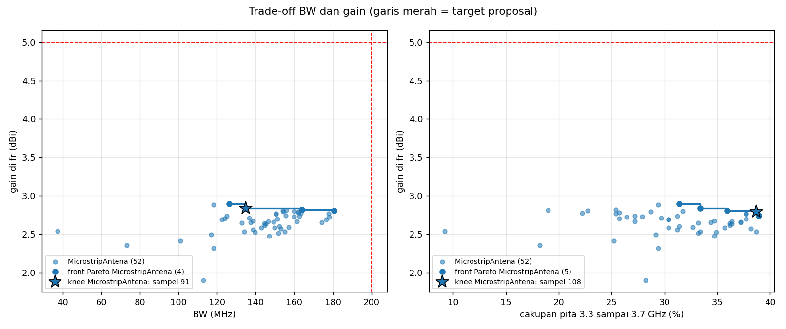
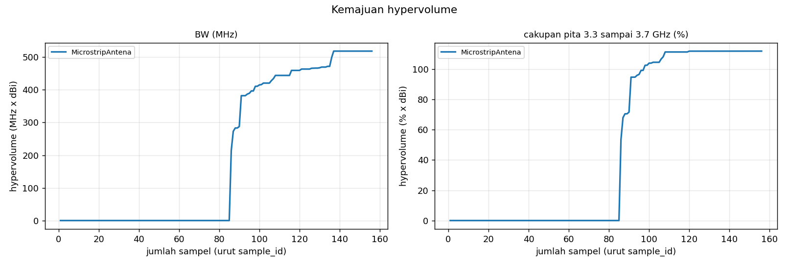
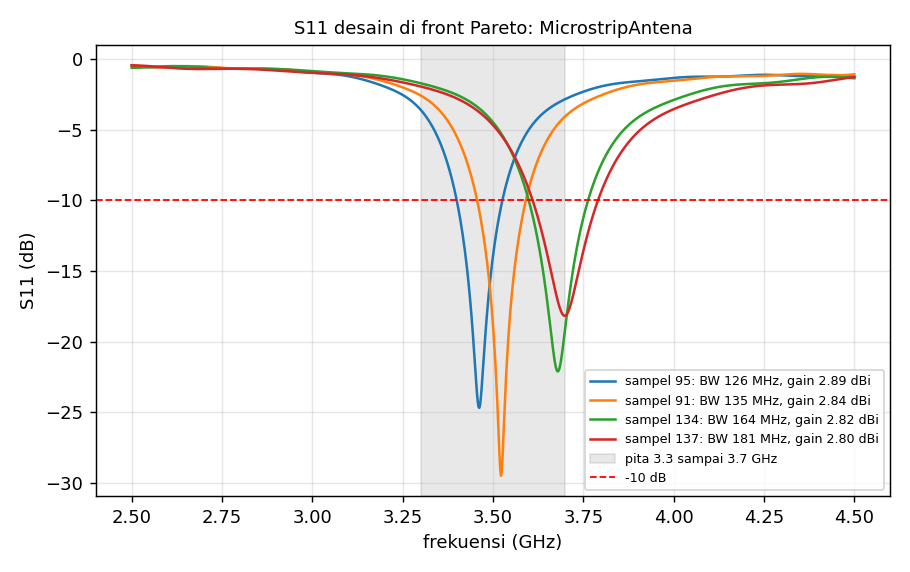
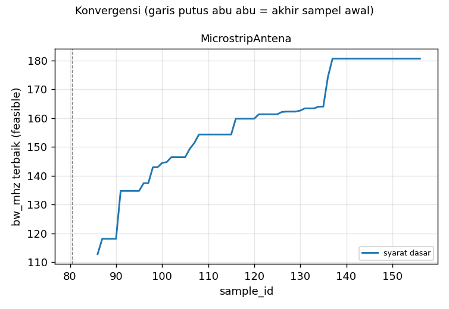
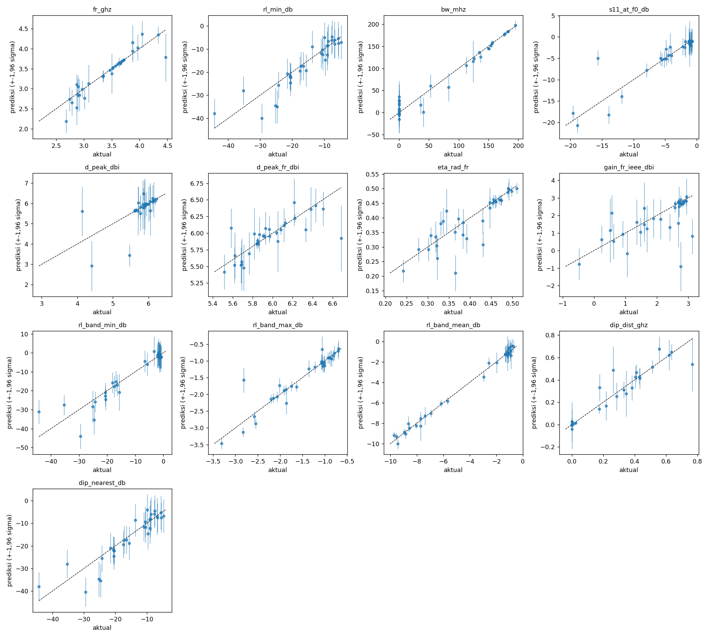
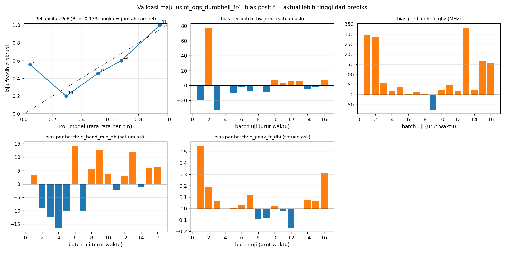
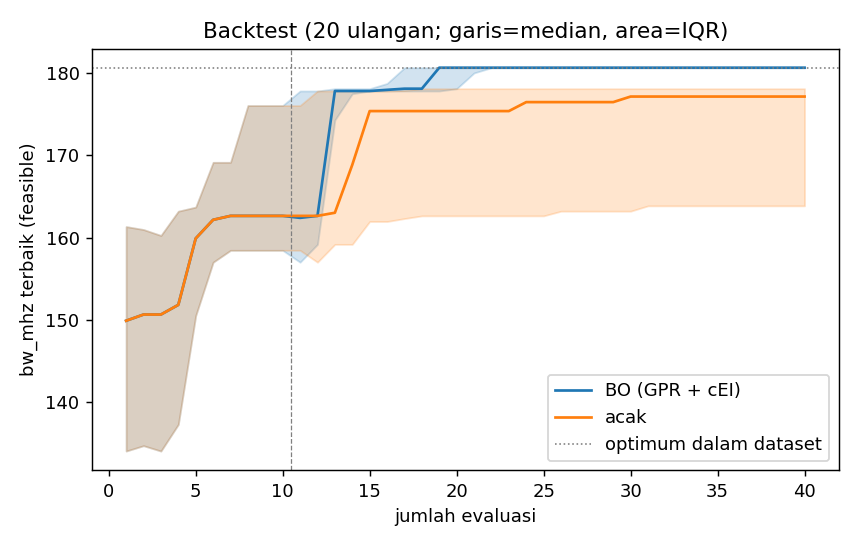
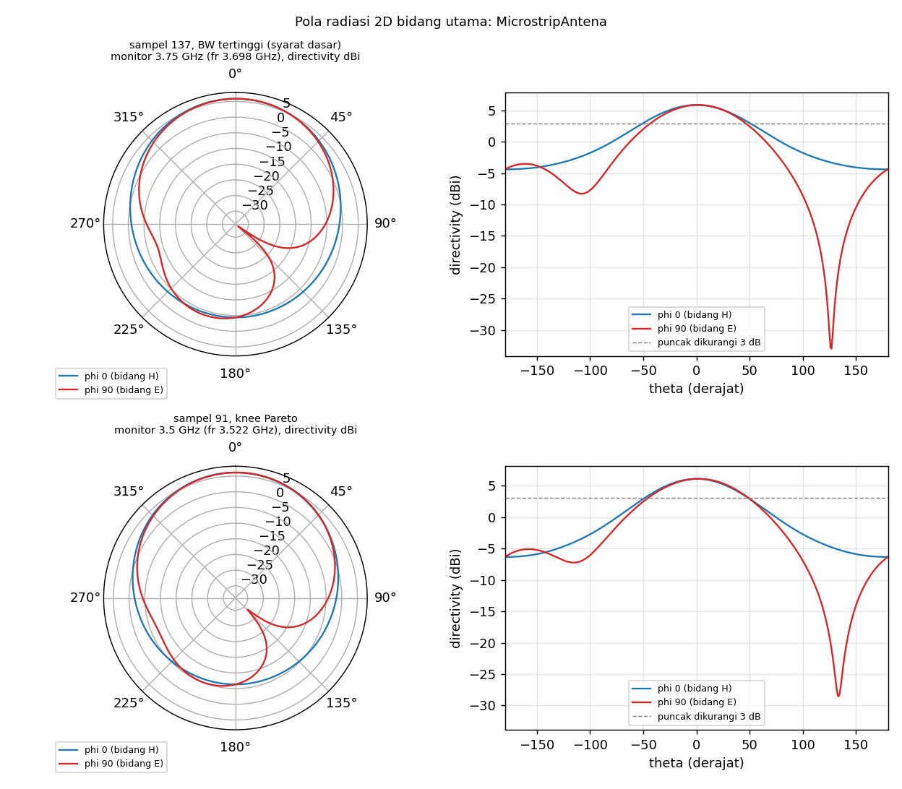
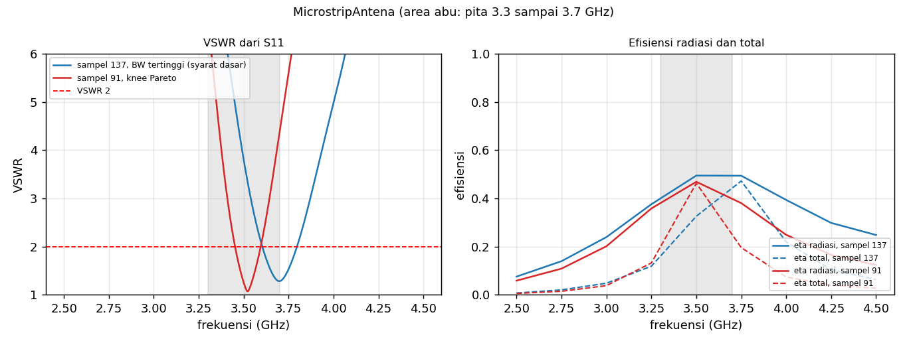
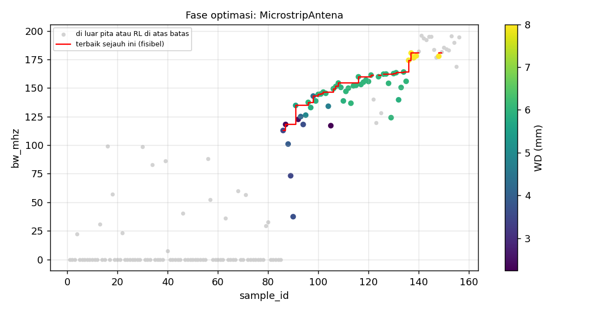

# Laporan hasil optimasi antena

## 1. Informasi reproduksi

- Tanggal: 2026-11-22
- Commit git: e5c87d76651d9b2a19c48de80bcc70531d1ba519
- Paket: Python 3.10.0, numpy 2.2.6, pandas 2.3.3, sklearn 1.7.2, scipy 1.15.3, matplotlib 3.10.9
- Sampel per run: MicrostripAntena 156 sampel
- Syarat dasar: fr 3.3 sampai 3.7 GHz dan RL minimum <= -10 dB; desain BW tertinggi dipilih dengan memaksimalkan bw_mhz; desain rekomendasi: bw_mhz tertinggi di antara desain dengan yield toleransi >= 90%

## 2. Definisi

- BW: lebar pita S11 <= -10 dB di sekitar minimum global (BW = 0 bila RL minimum > -10 dB).
- Cakupan pita: persentase frekuensi di 3.3 sampai 3.7 GHz dengan S11 <= -10 dB.
- Gain: gain IEEE di frekuensi resonansi (D + 10 log eta).
- Substrat: nilai epsilon dan tan delta di bawah berasal dari file desain; konfirmasikan dengan material library CST.
- Target proposal: fr 3.3 sampai 3.7 GHz, RL minimum <= -10 dB, BW >= 200 MHz, gain >= 5 dBi.

## 3. Target dan hasil tercapai

### MicrostripAntena: skenario syarat dasar

Desain dengan bw_mhz tertinggi: sampel 137 (52 sampel memenuhi syarat skenario ini); tanpa data toleransi.

| besaran | target proposal | tercapai | selisih terhadap target | status |
|---|---|---|---|---|
| fr (GHz) | 3.3 sampai 3.7 | 3.698 | 2 MHz dari tepi pita terdekat | tercapai |
| RL minimum (dB) | <= -10 | -18.2 | -8.2 dB | tercapai |
| BW (MHz) | >= 200 | 180.6 | -19.4 MHz (90% dari target) | tidak tercapai |
| BW pecahan (%) | tidak ada | 4.88 |  | acuan |
| Cakupan pita (%) | tidak ada | 22.7 |  | acuan |
| Gain IEEE (dBi) | >= 5 | 2.80 | -2.20 dB | tidak tercapai |
| Efisiensi radiasi di fr (%) | tidak ada | 49.4 |  | acuan |
| Directivity di fr (dBi) | tidak ada | 5.87 |  | acuan |

Maksimum terpisah pada skenario ini: BW 180.6 MHz (sampel 137, gain 2.80 dBi); gain 2.89 dBi (sampel 95, BW 126.2 MHz).

Tidak ada sampel yang memenuhi BW >= 200 MHz dan gain >= 5 dBi sekaligus (kedua target proposal). Tidak ada sampel dengan gain >= 5 dBi pada skenario ini.

## 4. Parameter desain terbaik

### MicrostripAntena: sampel 137 (desain BW tertinggi, skenario syarat dasar)

| parameter | nilai (mm) |
|---|---|
| Lp | 17.611 |
| Wp | 23.652 |
| LU | 4.773 |
| WU | 5.480 |
| gU | 0.942 |
| PU | 1.630 |
| LI | 5.900 |
| LD | 3.754 |
| WD | 8.000 |
| gD | 0.545 |
| PD | 0.000 |
| substrat | FR-4 (lossy): epsilon 4.3, tan delta 0.025, h 1.6 mm |

## 5. Kurva Pareto

Hypervolume (acuan 0, 0; satuan MHz*dBi untuk BW dan %*dBi untuk cakupan; makin besar makin baik):

| run | sumbu | hypervolume | titik front | knee (sampel) |
|---|---|---|---|---|
| MicrostripAntena | BW | 518.5 | 4 | 91 |
| MicrostripAntena | cakupan pita | 111.9 | 5 | 108 |

Titik front BW terhadap gain (BW menurun):

**MicrostripAntena**

| sampel | BW (MHz) | gain (dBi) | fr (GHz) | RL min (dB) | cakupan (%) |
|---|---|---|---|---|---|
| 137 | 180.6 | 2.80 | 3.698 | -18.2 | 22.7 |
| 134 | 164.0 | 2.82 | 3.680 | -22.1 | 25.4 |
| 91 | 134.8 | 2.84 | 3.522 | -29.5 | 33.4 |
| 95 | 126.2 | 2.89 | 3.462 | -24.7 | 31.4 |

## 6. Overlay S11 desain di front Pareto

## 7. Metode: konvergensi BO dan model

Parity GPR (MicrostripAntena):

Validasi maju (MicrostripAntena):

Backtest BO vs acak (MicrostripAntena):

## 8. Catatan otomatis

- Front MicrostripAntena (BW) belum representatif: hanya 4 titik (minimal 6).
- Front MicrostripAntena (cakupan pita) belum representatif: hanya 5 titik (minimal 6).
- MicrostripAntena: tidak ada data toleransi (tolerance_MicrostripAntena_yield.csv); desain rekomendasi tidak dibuat. Jalankan tools/analyze_tolerance.py --run MicrostripAntena.
- MicrostripAntena: sampel 137 (desain BW tertinggi): WD = 8.000 mm berada di batas atas rentang efektif (8.000 mm); optimum mungkin dibatasi rentang.
- Sensitivitas ARD dan Sobol (MicrostripAntena): sensitivity.png belum ada di C:\Users\User\Playground\CST_Auto\data\MicrostripAntena\figures (jalankan train, validate, backtest, atau sensitivity).
- MicrostripAntena: 2 sampel punya fr menempel di tepi sweep; resonansi sebenarnya mungkin di luar rentang sweep.

## 9. Pola radiasi, metrik tambahan, dan fase optimasi

Bagian ini dibaca dari berkas yang sudah ada (`curves/`, `eff/`, `ff/`, `batch_lhs.csv`). Pola yang tersimpan adalah DIRECTIVITY (dBi) pada irisan phi = 0 dan phi = 90 di frekuensi monitor terdekat dengan fr; gain di tabel ringkas dihitung terpisah dan dibatasi di fr, bukan di seluruh pita. Bidang E atau H ditentukan dari komponen dominan di boresight. Sumbu theta bertanda: sisi positif adalah sisi phi irisan, sisi negatif adalah phi + 180.

### 9.1 MicrostripAntena

**Tabel ringkas desain final**

| sampel | peran | fr (GHz) | RL min (dB) | VSWR | BW (MHz) | cakupan pita (%) | directivity di fr (dBi) | gain di fr (dBi) | eta radiasi di fr | eta total di fr |
|---|---|---|---|---|---|---|---|---|---|---|
| 137 | BW tertinggi (syarat dasar) | 3.698 | -18.167 | 1.282 | 180.630 | 22.700 | 5.867 | 2.803 | 0.494 | 0.442 |
| 91 | knee Pareto | 3.522 | -29.482 | 1.069 | 134.750 | 33.400 | 6.126 | 2.836 | 0.461 | 0.439 |

**Pola radiasi 2D (directivity)**

**Metrik pola** (HPBW: lebar sudut dengan directivity di atas puncak dikurangi 3 dB; F/B: puncak dikurangi maksimum di belahan belakang, yaitu sudut 90 derajat atau lebih dari arah puncak; XPD: komponen utama di arah puncak dikurangi komponen silang maksimum di sektor HPBW; nilai di atas sekitar 60 dB mencerminkan batas numerik simulasi pada geometri simetris, bukan komponen silang yang bisa diukur)

| sampel | peran | f (GHz) | phi | bidang | Dmax (dBi) | arah puncak (derajat) | HPBW (derajat) | F/B (dB) | XPD sektor HPBW (dB) | AR boresight (dB) |
|---|---|---|---|---|---|---|---|---|---|---|
| 137 | BW tertinggi (syarat dasar) | 3.75 | 0 | H | 5.86 | 0.00 | 102.65 | 6.84 | 22.10 | 40.00 |
| 137 | BW tertinggi (syarat dasar) | 3.75 | 90 | E | 5.87 | 2.00 | 90.76 | 9.38 | 95.12 | 40.00 |
| 91 | knee Pareto | 3.50 | 0 | H | 6.12 | 0.00 | 96.61 | 7.84 | 23.17 | 40.00 |
| 91 | knee Pareto | 3.50 | 90 | E | 6.13 | 2.00 | 93.62 | 10.06 | 71.95 | 40.00 |

**VSWR dan efisiensi terhadap frekuensi**

**Fase optimasi** (titik berwarna: sampel fisibel di pita dengan RL sesuai batas, tanpa syarat gain)

Parameter pewarna: WD (korelasi Spearman +0.86 terhadap bw_mhz pada sampel fisibel). Lompatan terbesar pada terbaik sejauh ini: 118.1 ke 134.8 pada sampel 91. Nilai maksimum WD sebelum sampel itu 4.97 mm dan sesudahnya 8.00 mm; bila keduanya berbeda jauh, periksa apakah rentang parameter diubah di tengah pengumpulan (wilayah lama terbatas oleh batas).
