# Laporan hasil optimasi antena

## 1. Informasi reproduksi

- Tanggal: 2026-11-22
- Commit git: e5c87d76651d9b2a19c48de80bcc70531d1ba519
- Paket: Python 3.10.0, numpy 2.2.6, pandas 2.3.3, sklearn 1.7.2, scipy 1.15.3, matplotlib 3.10.9
- Sampel per run: MicrostripAntena_RO4350B 185 sampel
- Syarat dasar: fr 3.3 sampai 3.7 GHz dan RL minimum <= -10 dB; desain BW tertinggi dipilih dengan memaksimalkan bw_mhz; desain rekomendasi: bw_mhz tertinggi di antara desain dengan yield toleransi >= 90%

## 2. Definisi

- BW: lebar pita S11 <= -10 dB di sekitar minimum global (BW = 0 bila RL minimum > -10 dB).
- Cakupan pita: persentase frekuensi di 3.3 sampai 3.7 GHz dengan S11 <= -10 dB.
- Gain: gain IEEE di frekuensi resonansi (D + 10 log eta).
- Substrat: nilai epsilon dan tan delta di bawah berasal dari file desain; konfirmasikan dengan material library CST.
- Target proposal: fr 3.3 sampai 3.7 GHz, RL minimum <= -10 dB, BW >= 200 MHz, gain >= 5 dBi.

## 3. Target dan hasil tercapai

### MicrostripAntena_RO4350B: skenario syarat dasar

Desain dengan bw_mhz tertinggi: sampel 179 (177 sampel memenuhi syarat skenario ini); yield toleransi 17.4% (4 dari 23 skenario lulus; di bawah ambang 90%, tidak tahan toleransi).

| besaran | target proposal | tercapai | selisih terhadap target | status |
|---|---|---|---|---|
| fr (GHz) | 3.3 sampai 3.7 | 3.534 | 166 MHz dari tepi pita terdekat | tercapai |
| RL minimum (dB) | <= -10 | -22.1 | -12.1 dB | tercapai |
| BW (MHz) | >= 200 | 247.5 | +47.5 MHz (124% dari target) | tercapai |
| BW pecahan (%) | tidak ada | 7.00 |  | acuan |
| Cakupan pita (%) | tidak ada | 61.8 |  | acuan |
| Gain IEEE (dBi) | >= 5 | 4.43 | -0.57 dB | tidak tercapai |
| Efisiensi radiasi di fr (%) | tidak ada | 83.4 |  | acuan |
| Directivity di fr (dBi) | tidak ada | 5.17 |  | acuan |

Maksimum terpisah pada skenario ini: BW 247.5 MHz (sampel 179, gain 4.43 dBi); gain 5.82 dBi (sampel 102, BW 115.8 MHz).

Tidak ada sampel yang memenuhi BW >= 200 MHz dan gain >= 5 dBi sekaligus (kedua target proposal). Untuk gain >= 5 dBi, BW terbesar adalah 158.6 MHz (sampel 165, gain 5.03 dBi).

**Desain rekomendasi (tahan toleransi, yield >= 90%)**: sampel 180; yield toleransi 96.4% (27 dari 28 skenario lulus; tahan toleransi).

| besaran | target proposal | tercapai | selisih terhadap target | status |
|---|---|---|---|---|
| fr (GHz) | 3.3 sampai 3.7 | 3.514 | 186 MHz dari tepi pita terdekat | tercapai |
| RL minimum (dB) | <= -10 | -26.4 | -16.4 dB | tercapai |
| BW (MHz) | >= 200 | 228.2 | +28.2 MHz (114% dari target) | tercapai |
| BW pecahan (%) | tidak ada | 6.49 |  | acuan |
| Cakupan pita (%) | tidak ada | 56.9 |  | acuan |
| Gain IEEE (dBi) | >= 5 | 4.63 | -0.37 dB | tidak tercapai |
| Efisiensi radiasi di fr (%) | tidak ada | 85.9 |  | acuan |
| Directivity di fr (dBi) | tidak ada | 5.27 |  | acuan |

## 4. Parameter desain terbaik

### MicrostripAntena_RO4350B: sampel 179 (desain BW tertinggi, skenario syarat dasar)

| parameter | nilai (mm) |
|---|---|
| Lp | 17.854 |
| Wp | 30.795 |
| LU | 2.636 |
| WU | 5.893 |
| gU | 1.149 |
| PU | 3.551 |
| LI | 6.157 |
| LD | 6.523 |
| WD | 18.000 |
| gD | 1.009 |
| PD | 1.117 |
| substrat | Rogers RO4350B (lossy): epsilon 3.66, tan delta 0.0037, h 1.524 mm |

### MicrostripAntena_RO4350B: sampel 180 (desain rekomendasi tahan toleransi, skenario syarat dasar)

| parameter | nilai (mm) |
|---|---|
| Lp | 17.925 |
| Wp | 31.006 |
| LU | 2.368 |
| WU | 3.560 |
| gU | 0.709 |
| PU | 2.788 |
| LI | 5.972 |
| LD | 6.495 |
| WD | 17.838 |
| gD | 1.165 |
| PD | 0.740 |
| substrat | Rogers RO4350B (lossy): epsilon 3.66, tan delta 0.0037, h 1.524 mm |

## 5. Kurva Pareto

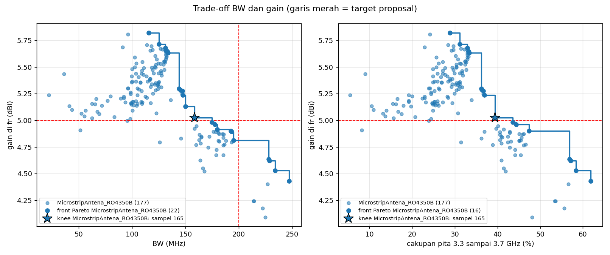

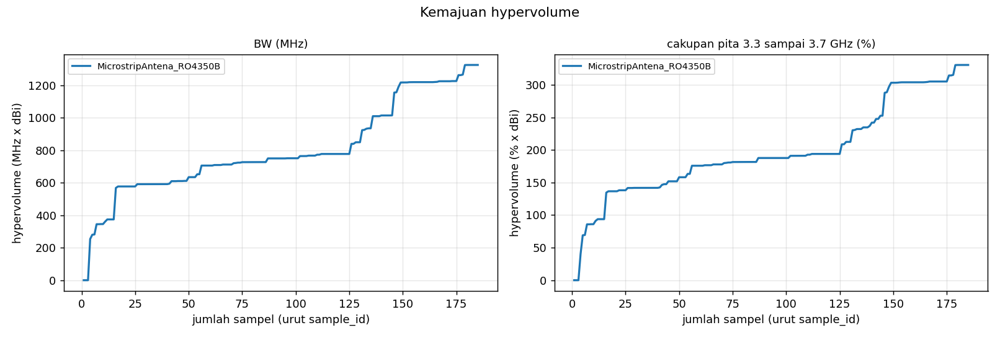

Hypervolume (acuan 0, 0; satuan MHz*dBi untuk BW dan %*dBi untuk cakupan; makin besar makin baik):

| run | sumbu | hypervolume | titik front | knee (sampel) |
|---|---|---|---|---|
| MicrostripAntena_RO4350B | BW | 1324.9 | 22 | 165 |
| MicrostripAntena_RO4350B | cakupan pita | 330.4 | 16 | 165 |

Titik front BW terhadap gain (BW menurun):

**MicrostripAntena_RO4350B**

| sampel | BW (MHz) | gain (dBi) | fr (GHz) | RL min (dB) | cakupan (%) |
|---|---|---|---|---|---|
| 179 | 247.5 | 4.43 | 3.534 | -22.1 | 61.8 |
| 176 | 234.2 | 4.53 | 3.514 | -21.1 | 58.4 |
| 178 | 228.9 | 4.62 | 3.544 | -28.7 | 57.1 |
| 180 | 228.2 | 4.63 | 3.514 | -26.4 | 56.9 |
| 173 | 195.1 | 4.81 | 3.616 | -32.2 | 45.4 |
| 174 | 193.4 | 4.89 | 3.650 | -26.3 | 36.9 |
| 167 | 192.8 | 4.90 | 3.606 | -21.7 | 47.4 |
| 136 | 180.1 | 4.92 | 3.622 | -19.0 | 41.4 |
| 185 | 177.9 | 4.96 | 3.456 | -16.4 | 44.4 |
| 166 | 175.1 | 4.98 | 3.604 | -19.4 | 43.6 |
| 165 | 158.6 | 5.03 | 3.616 | -24.9 | 39.4 |
| 145 | 150.0 | 5.13 | 3.694 | -29.8 | 19.7 |
| 128 | 147.5 | 5.24 | 3.608 | -23.1 | 36.9 |
| 130 | 147.2 | 5.28 | 3.614 | -23.4 | 36.7 |
| 126 | 145.7 | 5.28 | 3.600 | -23.1 | 36.2 |
| 127 | 144.2 | 5.30 | 3.614 | -27.3 | 36.2 |
| 112 | 133.9 | 5.63 | 3.604 | -22.2 | 33.4 |
| 110 | 133.1 | 5.65 | 3.614 | -25.1 | 33.2 |
| 96 | 131.6 | 5.66 | 3.618 | -26.0 | 32.9 |
| 87 | 131.5 | 5.68 | 3.616 | -26.1 | 32.9 |
| 105 | 125.2 | 5.71 | 3.590 | -37.5 | 31.2 |
| 102 | 115.8 | 5.82 | 3.592 | -41.2 | 28.9 |

## 6. Overlay S11 desain di front Pareto

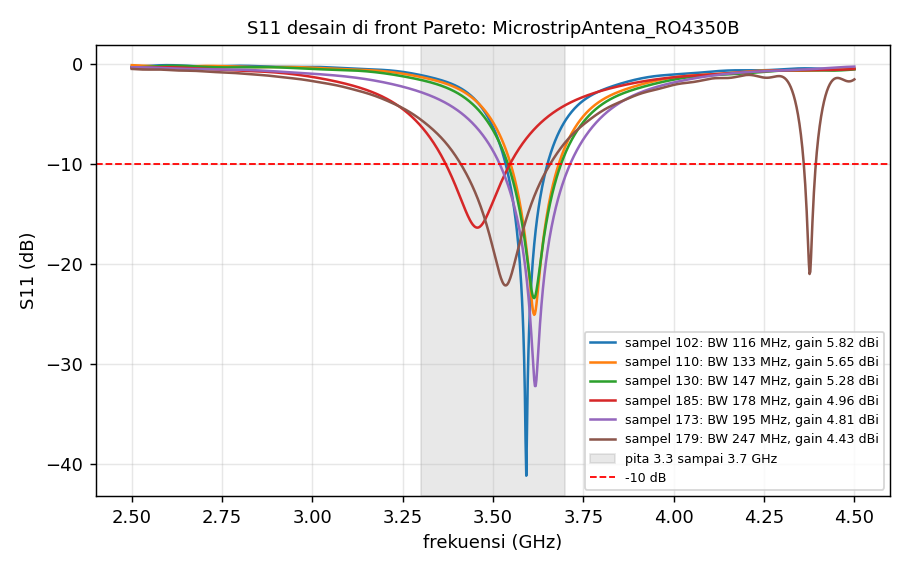

## 7. Metode: konvergensi BO dan model

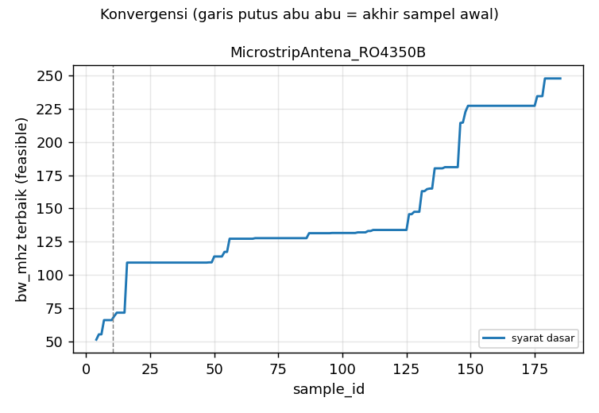

Parity GPR (MicrostripAntena_RO4350B):

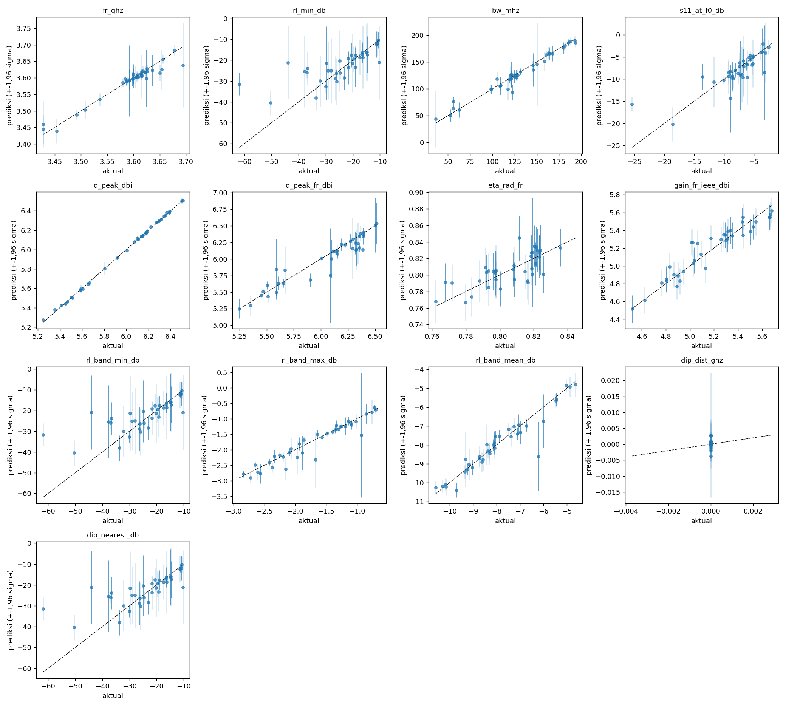

Validasi maju (MicrostripAntena_RO4350B):

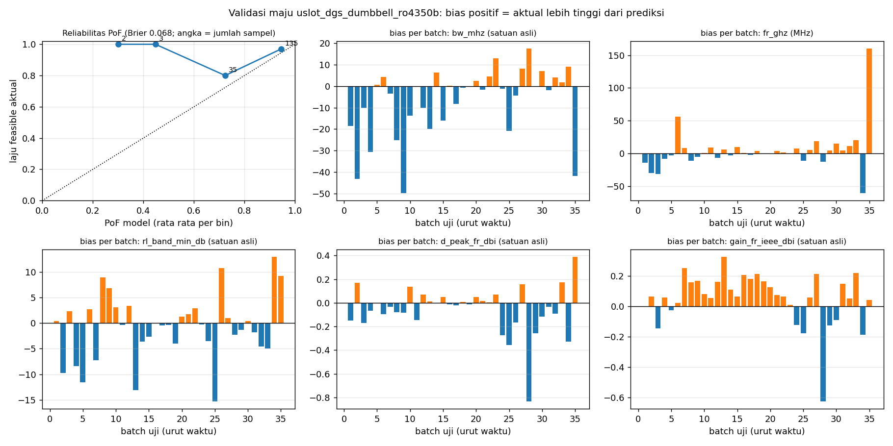

Backtest BO vs acak (MicrostripAntena_RO4350B):

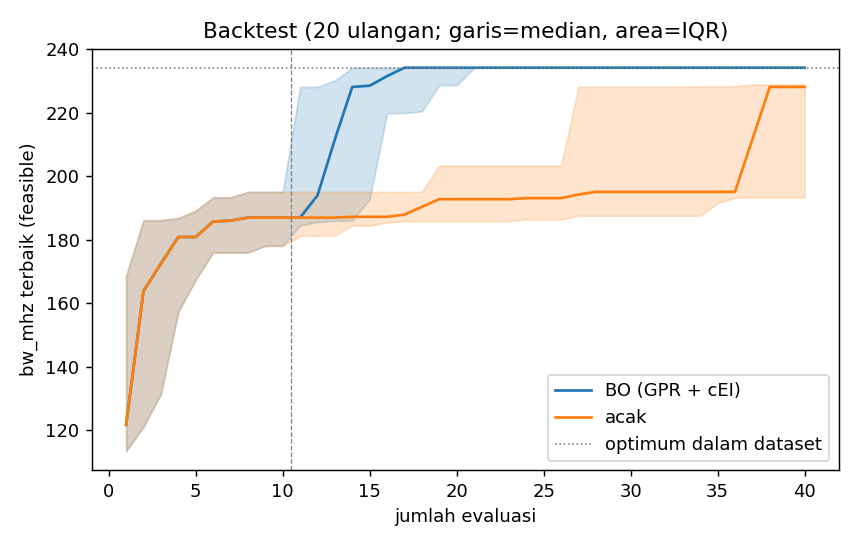

Sensitivitas ARD dan Sobol (MicrostripAntena_RO4350B):

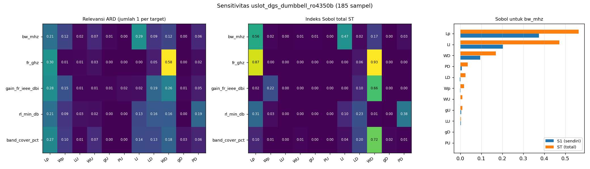

## 8. Catatan otomatis

- MicrostripAntena_RO4350B: sampel 179 (desain BW tertinggi): WD = 18.000 mm berada di batas atas rentang efektif (18.000 mm); optimum mungkin dibatasi rentang.

## 9. Pola radiasi, metrik tambahan, dan fase optimasi

Bagian ini dibaca dari berkas yang sudah ada (`curves/`, `eff/`, `ff/`, `batch_lhs.csv`). Pola yang tersimpan adalah DIRECTIVITY (dBi) pada irisan phi = 0 dan phi = 90 di frekuensi monitor terdekat dengan fr; gain di tabel ringkas dihitung terpisah dan dibatasi di fr, bukan di seluruh pita. Bidang E atau H ditentukan dari komponen dominan di boresight. Sumbu theta bertanda: sisi positif adalah sisi phi irisan, sisi negatif adalah phi + 180.

### 9.1 MicrostripAntena_RO4350B

**Tabel ringkas desain final**

| sampel | peran | fr (GHz) | RL min (dB) | VSWR | BW (MHz) | cakupan pita (%) | directivity di fr (dBi) | gain di fr (dBi) | eta radiasi di fr | eta total di fr |
|---|---|---|---|---|---|---|---|---|---|---|
| 179 | BW tertinggi (syarat dasar) | 3.534 | -22.144 | 1.169 | 247.490 | 61.800 | 5.174 | 4.429 | 0.834 | 0.797 |
| 180 | rekomendasi tahan toleransi | 3.514 | -26.415 | 1.100 | 228.150 | 56.900 | 5.272 | 4.634 | 0.859 | 0.841 |
| 165 | knee Pareto | 3.616 | -24.900 | 1.121 | 158.570 | 39.400 | 5.669 | 5.026 | 0.823 | 0.647 |

**Pola radiasi 2D (directivity)**

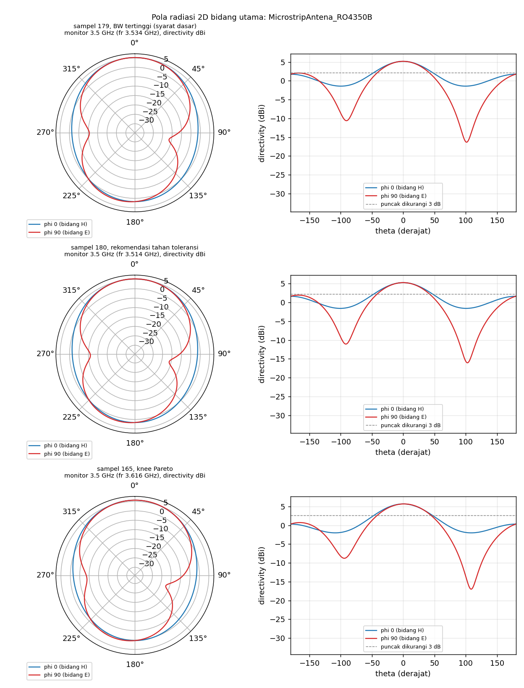

**Metrik pola** (HPBW: lebar sudut dengan directivity di atas puncak dikurangi 3 dB; F/B: puncak dikurangi maksimum di belahan belakang, yaitu sudut 90 derajat atau lebih dari arah puncak; XPD: komponen utama di arah puncak dikurangi komponen silang maksimum di sektor HPBW; nilai di atas sekitar 60 dB mencerminkan batas numerik simulasi pada geometri simetris, bukan komponen silang yang bisa diukur)

| sampel | peran | f (GHz) | phi | bidang | Dmax (dBi) | arah puncak (derajat) | HPBW (derajat) | F/B (dB) | XPD sektor HPBW (dB) | AR boresight (dB) |
|---|---|---|---|---|---|---|---|---|---|---|
| 179 | BW tertinggi (syarat dasar) | 3.50 | 0 | H | 5.17 | 0.00 | 94.08 | 3.42 | 22.90 | 40.00 |
| 179 | BW tertinggi (syarat dasar) | 3.50 | 90 | E | 5.17 | 0.00 | 82.62 | 3.11 | 84.09 | 40.00 |
| 180 | rekomendasi tahan toleransi | 3.50 | 0 | H | 5.27 | 0.00 | 93.28 | 3.63 | 23.93 | 40.00 |
| 180 | rekomendasi tahan toleransi | 3.50 | 90 | E | 5.27 | 0.00 | 83.22 | 3.33 | 77.63 | 40.00 |
| 165 | knee Pareto | 3.50 | 0 | H | 5.67 | 0.00 | 92.73 | 5.36 | 23.20 | 40.00 |
| 165 | knee Pareto | 3.50 | 90 | E | 5.67 | 1.00 | 85.36 | 4.95 | 91.35 | 40.00 |

**VSWR dan efisiensi terhadap frekuensi**

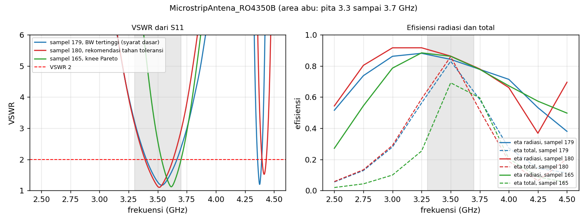

**Toleransi fabrikasi** (dari `tools/analyze_tolerance.py`)

| sample_id | besaran | nominal | minimum | maksimum | simpangan_baku | selisih_maks | n |
|---|---|---|---|---|---|---|---|
| 165 | fr_ghz | 3.616 | 3.588 | 3.664 | 0.021 | 0.048 | 20 |
| 165 | rl_min_db | -24.900 | -27.553 | -22.919 | 1.331 | 2.653 | 20 |
| 165 | bw_mhz | 158.570 | 151.170 | 164.240 | 3.753 | 7.400 | 20 |
| 165 | gain_fr_ieee_dbi | 5.026 | 4.809 | 5.095 | 0.083 | 0.217 | 20 |
| 179 | fr_ghz | 3.534 | 3.508 | 4.376 | 0.176 | 0.842 | 23 |
| 179 | rl_min_db | -22.144 | -26.425 | -19.040 | 1.458 | 4.281 | 23 |
| 179 | bw_mhz | 247.490 | 33.210 | 257.770 | 44.538 | 214.280 | 23 |
| 179 | gain_fr_ieee_dbi | 4.429 | 2.602 | 4.700 | 0.394 | 1.827 | 23 |
| 180 | fr_ghz | 3.514 | 3.468 | 3.542 | 0.017 | 0.046 | 28 |
| 180 | rl_min_db | -26.415 | -30.327 | -22.973 | 1.627 | 3.912 | 28 |
| 180 | bw_mhz | 228.150 | 215.400 | 235.650 | 4.595 | 12.750 | 28 |
| 180 | gain_fr_ieee_dbi | 4.634 | 4.476 | 4.657 | 0.046 | 0.158 | 28 |

| sample_id | plan | direncanakan | dilewati | belum_tersimulasi | tersimulasi | lulus | yield_pct |
|---|---|---|---|---|---|---|---|
| 165 | oat | 12 | 1 | 0 | 11 | 11 | 100.00 |
| 165 | corners | 4 | 2 | 0 | 2 | 2 | 100.00 |
| 165 | random | 12 | 5 | 0 | 7 | 7 | 100.00 |
| 165 | semua | 28 | 8 | 0 | 20 | 20 | 100.00 |
| 179 | oat | 12 | 1 | 0 | 11 | 1 | 9.09 |
| 179 | corners | 4 | 2 | 0 | 2 | 1 | 50.00 |
| 179 | random | 12 | 2 | 0 | 10 | 2 | 20.00 |
| 179 | semua | 28 | 5 | 0 | 23 | 4 | 17.39 |
| 180 | oat | 12 | 0 | 0 | 12 | 12 | 100.00 |
| 180 | corners | 4 | 0 | 0 | 4 | 3 | 75.00 |
| 180 | random | 12 | 0 | 0 | 12 | 12 | 100.00 |
| 180 | semua | 28 | 0 | 0 | 28 | 27 | 96.43 |

**Fase optimasi** (titik berwarna: sampel fisibel di pita dengan RL sesuai batas, tanpa syarat gain)

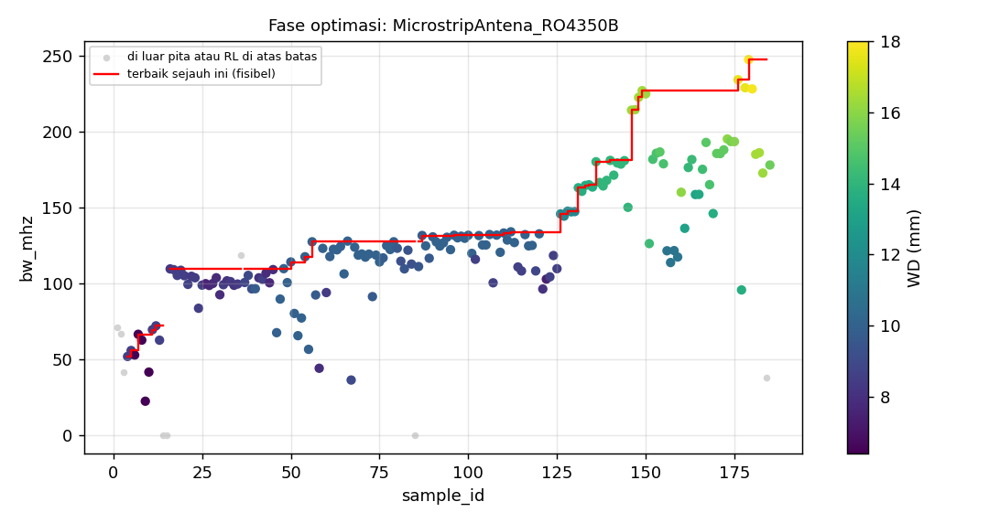

Parameter pewarna: WD (korelasi Spearman +0.89 terhadap bw_mhz pada sampel fisibel). Lompatan terbesar pada terbaik sejauh ini: 181.0 ke 214.1 pada sampel 146. Nilai maksimum WD sebelum sampel itu 14.00 mm dan sesudahnya 18.00 mm; bila keduanya berbeda jauh, periksa apakah rentang parameter diubah di tengah pengumpulan (wilayah lama terbatas oleh batas).
